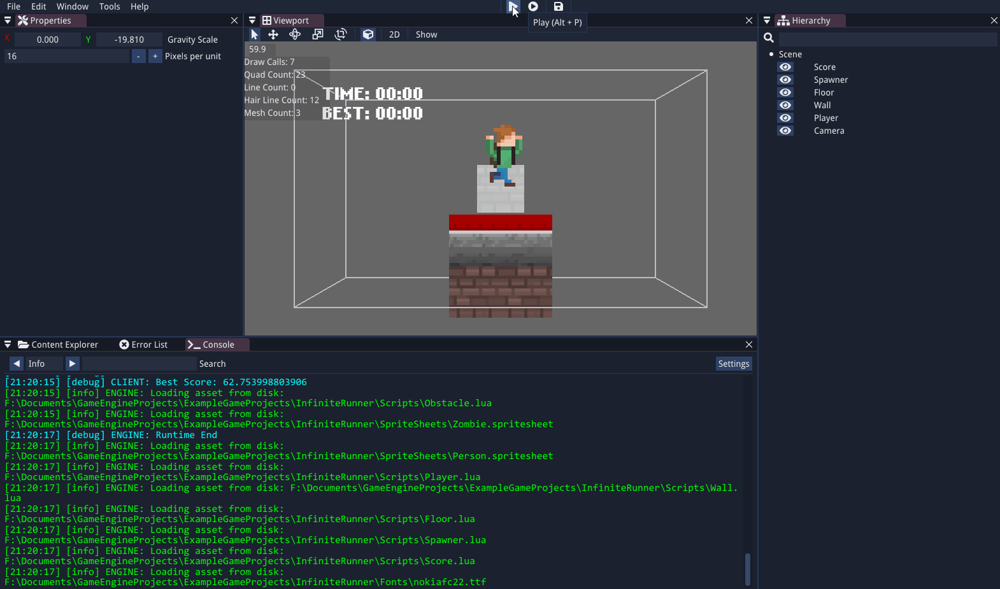
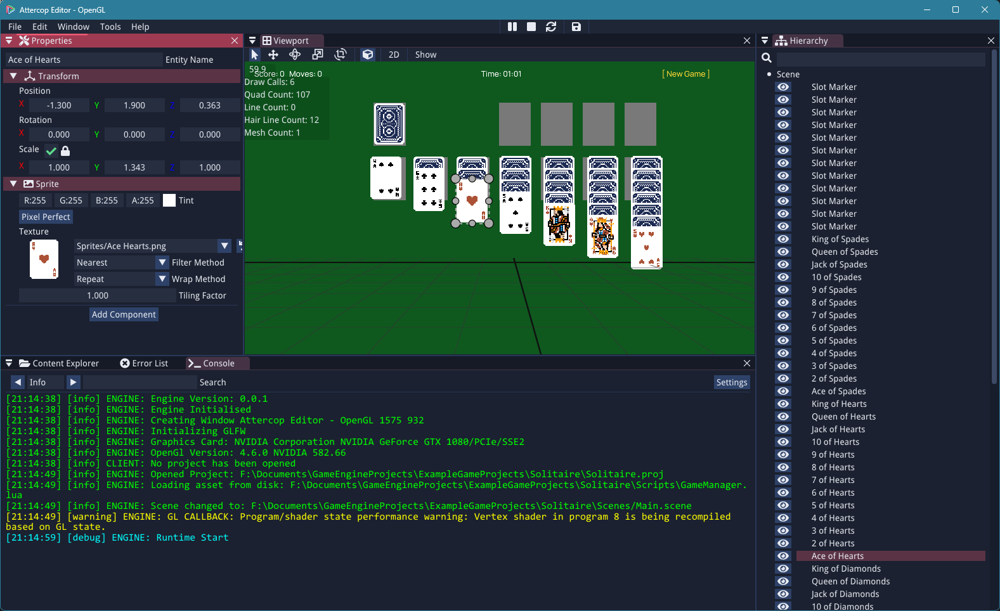
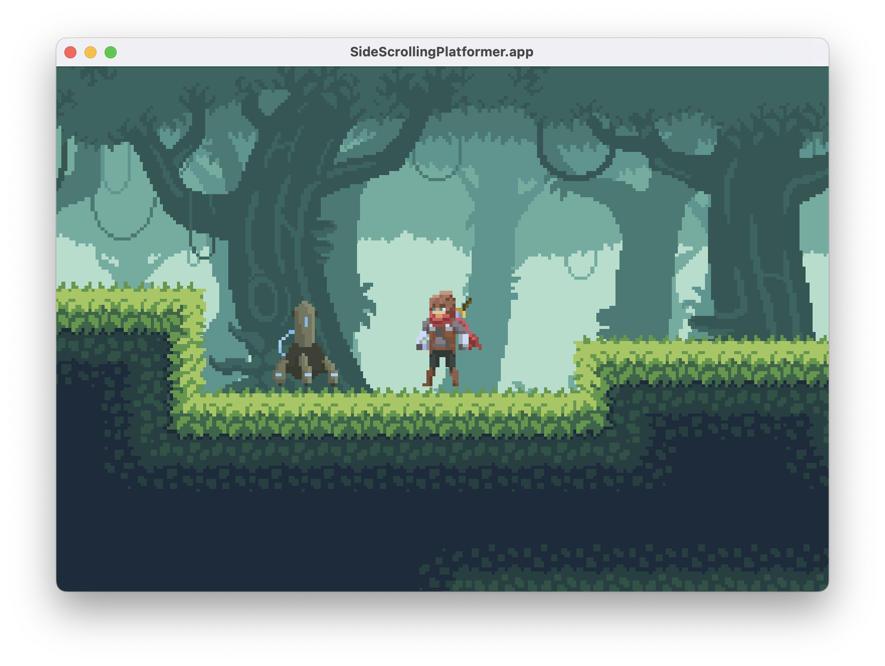
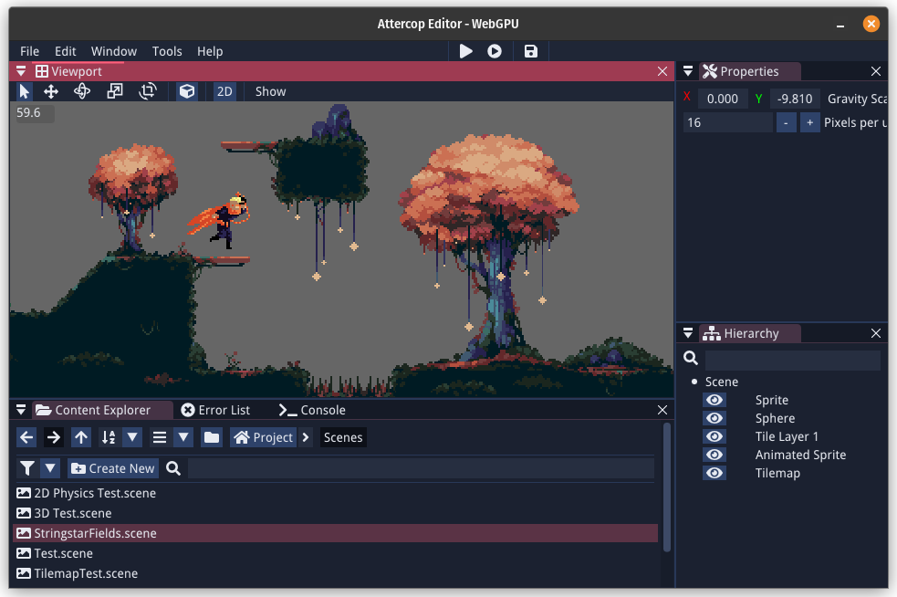
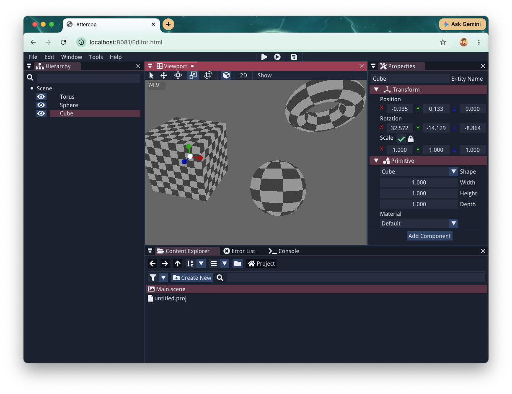

<p align="center">
  
</p>

<h1 align="center">Attercop</h1>

<p align="center">
  <b>A cross-platform game engine and editor, written in C++.</b><br>
  2D and 3D · OpenGL and WebGPU · Lua scripting · Windows, macOS, Linux and the Web
</p>

<p align="center">
  <a href="https://github.com/ThomasJowett/AttercopEngine/actions/workflows/cmake-multi-platform.yml"></a>
  <a href="https://thomasjowett.github.io/AttercopEngine/"></a>
  
  
  <a href="https://opensource.org/licenses/MIT"></a>
</p>

<p align="center">
  
</p>

<p align="center">
  <a href="https://thomasjowett.github.io/AttercopEngine/"><b>Documentation</b></a> ·
  <a href="https://thomasjowett.github.io/AttercopEngine/getting-started/"><b>Getting Started</b></a> ·
  <a href="https://github.com/ThomasJowett/ExampleGameProjects"><b>Example Projects</b></a> ·
  <a href="https://github.com/ThomasJowett/AttercopEngine/releases"><b>Releases</b></a>
</p>

---

## Runs everywhere

The same editor and the same projects, on every platform.

<table>
  <tr>
    <td align="center"><b>Windows</b></td>
    <td align="center"><b>macOS</b></td>
  </tr>
  <tr>
    <td></td>
    <td></td>
  </tr>
  <tr>
    <td align="center"><b>Linux</b></td>
    <td align="center"><b>Web</b></td>
  </tr>
  <tr>
    <td></td>
    <td></td>
  </tr>
</table>

## Features

**🕸️ A full editor**
- Dockable scene viewport, hierarchy, properties panel and content browser
- Play, pause and simulate your scene without leaving the editor
- Asset pipeline for textures, meshes, materials, tilesets, sprite sheets and audio
- Tilemap editor and a visual behaviour tree editor for AI
- Export a standalone build of your game from `File > Export Game`

**🎨 Rendering**
- OpenGL and WebGPU backends behind one renderer API
- 2D sprites, text (MSDF font atlases), tilemaps and 3D static meshes
- Post-processing effects

**⚙️ Gameplay**
- Entity-component system scene model, backed by [EnTT](https://github.com/skypjack/entt)
- 2D physics and particles via Box2D/[LiquidFun](https://github.com/google/liquidfun)
- In-game UI widgets and layouts
- Audio playback with [miniaudio](https://github.com/mackron/miniaudio)

**📜 Lua scripting**

Attach a script to any entity and give it behaviour:

```lua
function OnUpdate(deltaTime)
    local transform = CurrentEntity:GetTransformComponent()
    if Input.IsKeyPressed('D') then
        transform.Position = transform.Position + Vec3.new(3.0 * deltaTime, 0, 0)
    end
end
```

Components and engine systems are bound to Lua. See the
[Lua scripting guide](https://thomasjowett.github.io/AttercopEngine/lua-scripting/) and the
[Lua API reference](https://thomasjowett.github.io/AttercopEngine/LuaAPI/Entity/) for what's available.

## Getting Started

### Prerequisites
- A **C++17** compiler (MSVC, Clang or GCC)
- **CMake** 3.10 or newer

> [!IMPORTANT]
> This repository uses Git submodules, so clone it with `--recursive`:
> ```bash
> git clone --recursive https://github.com/ThomasJowett/AttercopEngine
> ```
> If you've already cloned without `--recursive`, initialise the submodules afterwards:
> ```bash
> git submodule update --init --recursive
> ```

### Building

**Windows**: generate Visual Studio project files with CMake, then build the `Editor` or `Runtime` target.

**macOS**: generate Xcode project files or Makefiles with CMake.

**Linux**: install the dependencies first:
```bash
sudo apt-get install -y libx11-dev libxrandr-dev libxi-dev libxinerama-dev libgl1-mesa-dev libxcursor-dev mesa-common-dev g++ make
```
Then generate Makefiles with CMake and build with `make`.

#### Build options

| Option | Default | Description |
| --- | --- | --- |
| `ATTERCOP_ENABLE_UNITY_BUILD` | `OFF` | Build with unity builds for faster compile times |
| `ATTERCOP_BUILD_SCENE_TESTS` | `ON` | Build `SceneTest` and register the scene tests with CTest |
| `ATTERCOP_ENABLE_PROFILING` | `OFF` | Enable profiling with [Tracy](https://github.com/wolfpld/tracy) |

### Running
Once built, run the `Editor` executable to open the editor.

`Runtime` doesn't open a project directly. It plays an already-**exported** game (see
[Exporting a game](https://thomasjowett.github.io/AttercopEngine/getting-started/#exporting-a-game)).
To try a project standalone, export it first (`File > Export Game` in the Editor, or headlessly with
`Editor <project>.proj --export-game <output-path>`), then run the resulting executable or app bundle.

## Example Projects
Example projects can be downloaded from [ExampleGameProjects](https://github.com/ThomasJowett/ExampleGameProjects).

## Dependencies
* [imgui](https://github.com/ocornut/imgui): Dear ImGui, a bloat-free immediate mode graphical user interface for C++.
* [EnTT](https://github.com/skypjack/entt): Fast and reliable entity-component system (ECS).
* [glfw](https://github.com/glfw/glfw): A multi-platform library for OpenGL, OpenGL ES, Vulkan, window and input.
* [spdlog](https://github.com/gabime/spdlog): Fast C++ logging library.
* [stb](https://github.com/nothings/stb): Single-file public domain (or MIT licensed) libraries for C/C++.
* [simpleini](https://github.com/brofield/simpleini): Simple initialization file parser and writer.
* [glad](https://github.com/Dav1dde/glad): Meta loader for the OpenGL API.
* [OpenFBX](https://github.com/nem0/OpenFBX): Lightweight FBX importer.
* [cereal](https://github.com/USCiLab/cereal): A C++11 library for serialization.
* [tinyxml2](https://github.com/leethomason/tinyxml2): A simple, small, efficient C++ XML parser.
* [LiquidFun](https://github.com/google/liquidfun): 2D physics library and extension of Box2D that provides particle and fluid dynamics.
* [lua](https://github.com/lua/lua): A powerful, efficient, lightweight, embeddable scripting language.
* [sol2](https://github.com/ThePhD/sol2): A C++ single header library binding to Lua.
* [msdf-atlas-gen](https://github.com/Chlumsky/msdf-atlas-gen): A utility for generating compact font atlases.
* [miniaudio](https://github.com/mackron/miniaudio): Audio playback and capture library.
* [Tracy](https://github.com/wolfpld/tracy): A real-time frame profiler.

## License
Attercop is released under the [MIT License](LICENSE).
