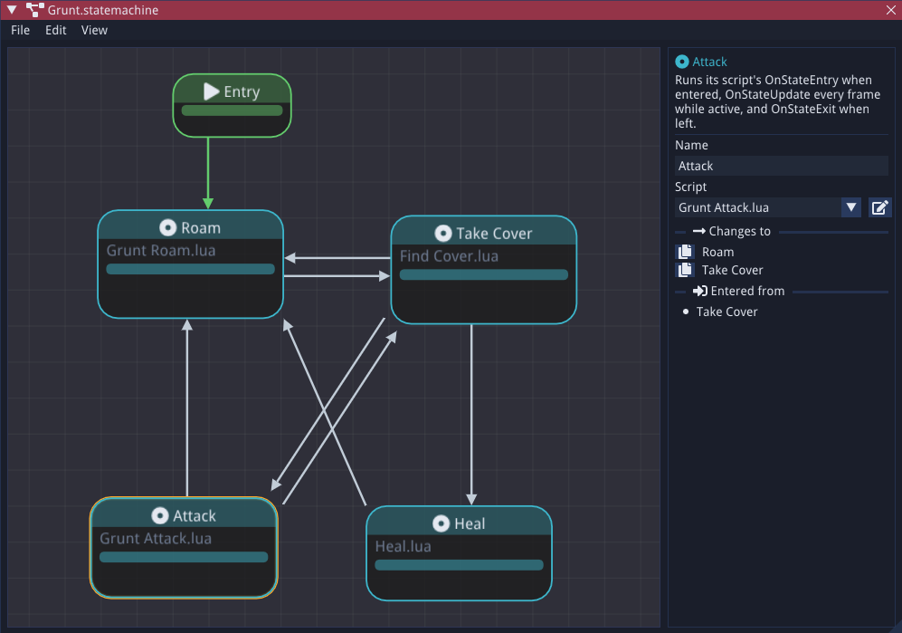

# State Machines

A state machine gives an entity a set of named states - Idle, Walk, Attack, Hurt - and keeps it
in exactly one of them at a time. Each state is a Lua script, and a state moves to another by
calling `StateMachine.ChangeState("Name")`. State machines are `.statemachine` files edited
visually in the Editor, and any entity with a `State Machine` component runs one while the game
is playing.

Reach for a state machine when an entity's behaviour splits into clear modes with obvious ways
in and out of each. For layered decisions with priorities and fallbacks, a
[behaviour tree](behaviour-trees.md) is usually a better fit.

One file can drive any number of entities. Each entity gets its own copy, with its own current
state and its own script variables.

## Creating a state machine

1. In the Content Explorer, choose **Create New > State Machine** and name the file.
2. Double-click it to open the state machine editor.
3. Select an entity, add a **State Machine** component in the Properties panel, and pick the
   file from its dropdown.

The state machine starts in its initial state when you press play.

## The editor



The canvas shows each state as a node, plus an **Entry** node whose arrow points at the
**initial state** - the state the machine starts in.

- **Add a state:** right-click the canvas and choose **Add State**, or drag from the bar along
  the bottom of a state into empty space to add a state with a transition to it already drawn.
- **Draw a transition:** drag from the bar along the bottom of one state and drop it anywhere on
  another. Two states that change to each other get a pair of side by side arrows.
- **Set the initial state:** select the Entry node and pick a state from the **Initial state**
  dropdown, or drag from the bar under the Entry node onto a state.
- **Delete:** select and press `Del`, or right-click a state or arrow. The Entry node can't be
  deleted.
- **Edit a state:** select it to set its name and script in the panel on the right. The panel
  also lists the states it changes to, with a button that copies the `ChangeState` call.
- **Undo, copy and paste:** the usual shortcuts work, including `Ctrl+D` to duplicate.
- **View menu:** **Zoom to content** fits every state on screen, and **Auto layout** arranges
  the states in columns by how far they are from the Entry.

State names must be unique, as scripts change state by name. Renaming a state doesn't update
the `ChangeState` calls in your scripts.

!!! note
    The arrows are a map of the changes your scripts make, for you and anyone else reading the
    state machine. They don't limit which states a script can change to - `ChangeState` works
    with any state in the file, whether or not an arrow is drawn.

## State scripts

A state's script can define any of these functions - all are optional:

| Function | Called |
|---|---|
| `OnStateEntry()` | Once, when the state becomes active. |
| `OnStateUpdate(deltaTime)` | Every frame while the state is active. |
| `OnStateExit()` | Once, when the machine leaves the state. |

The script runs with these globals:

- `CurrentEntity` - the entity the state machine is on
- `CurrentScene` - the currently loaded [Scene](LuaAPI/Scene.md)
- `StateMachine` - this entity's state machine, with `StateMachine.ChangeState(name)`,
  `StateMachine.GetCurrentStateName()` and `StateMachine.GetPreviousStateName()`

Each state gets its own copy of its script, so `local` variables at the top of the file belong
to that state on that entity. Several states can share one script file - each still gets its own
copy, and `StateMachine.GetCurrentStateName()` in `OnStateEntry` tells it which state it is.

```lua
-- Walk.lua
local timer = 0

function OnStateEntry()
    timer = 0
    CurrentEntity:GetAnimatedSpriteComponent().Animation = "Walk"
end

function OnStateUpdate(deltaTime)
    timer = timer + deltaTime
    if Input.IsKeyPressed(' ') then
        StateMachine.ChangeState("Attack")
    elseif timer > 5 then
        StateMachine.ChangeState("Idle")
    end
end
```

### How changes happen

When a state's own script calls `ChangeState`, the change waits until the function it was
called from returns. Then the old state's `OnStateExit` runs, followed by the new state's
`OnStateEntry`. The new state's `OnStateUpdate` first runs on the next frame. If `ChangeState`
is called more than once in the same function, the last call wins.

A state can change again straight from `OnStateEntry`, which is handy for states that only
decide where to go next. To stop a mistake from freezing the game, a chain of more than 16
changes in a row is cut off with an error. `ChangeState` calls made from `OnStateExit` are
ignored.

Changing to the state that's already active does nothing, and changing to a state that doesn't
exist logs an error and leaves the current state alone.

## Controlling a state machine from other scripts

A gameplay script can read and change an entity's state through its
[State Machine component](Components/scripting-ai/StateMachineComponent.md). From outside the
state scripts, `ChangeState` takes effect immediately:

```lua
function OnUpdate(deltaTime)
    local stateMachine = CurrentEntity:GetStateMachineComponent()
    if health <= 0 and stateMachine:GetCurrentStateName() ~= "Dead" then
        stateMachine:ChangeState("Dead")
    end
end
```

## File format

`.statemachine` files are XML, so they can also be written by hand:

```xml
<StateMachine EngineVersion="1" InitialState="Idle">
    <Entry x="0" y="0"/>
    <State Name="Idle" Filepath="Scripts/Player/Idle.lua" x="200" y="0"/>
    <State Name="Walk" Filepath="Scripts/Player/Walk.lua" x="440" y="0"/>
    <Transition From="Idle" To="Walk"/>
    <Transition From="Walk" To="Idle"/>
</StateMachine>
```

`x` and `y` are only used by the editor; if every state leaves them out, the editor lays the
states out automatically.
